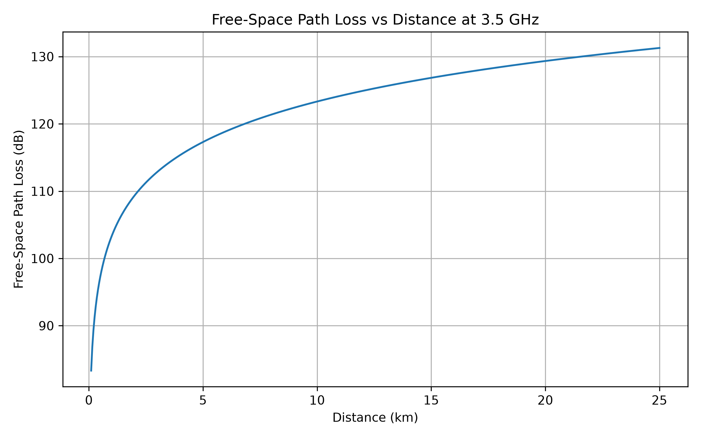
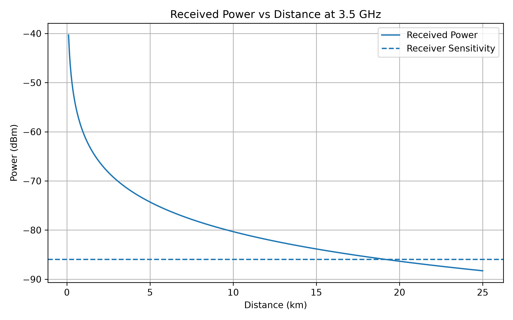
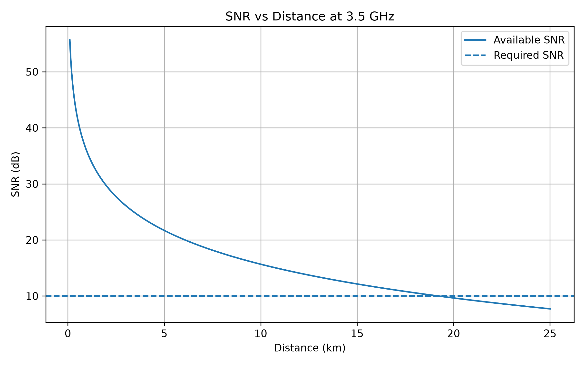
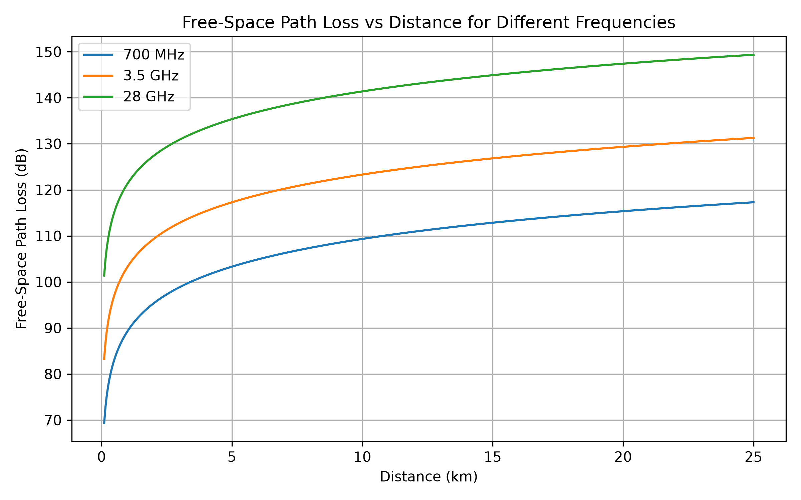
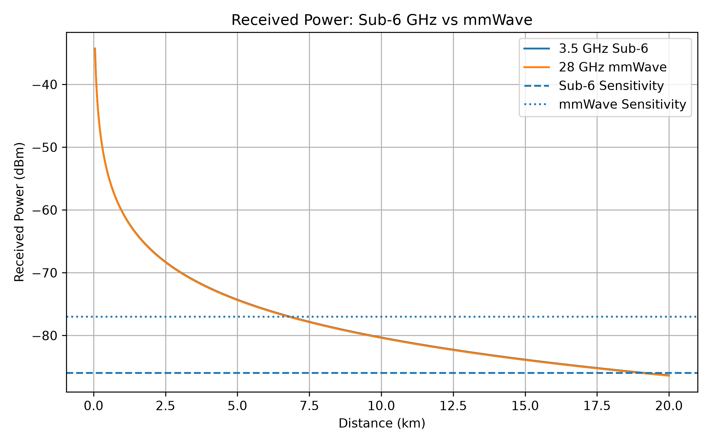
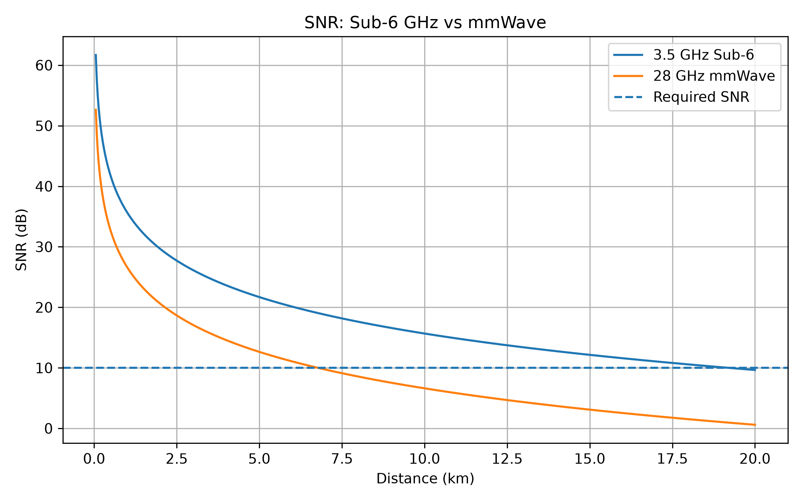
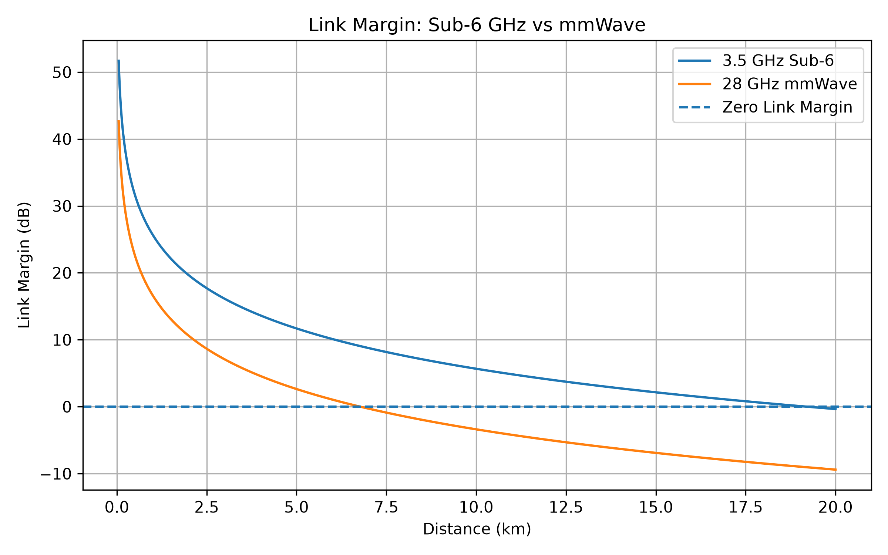

# Wireless Propagation & Link-Budget Simulator

A Python-based wireless link-budget simulator for analysing **sub-6 GHz**, **mmWave**, and a simplified **LEO satellite** communication link.

The project models the core quantities used in wireless-link engineering:

- Free-space path loss
- Received signal power
- Receiver thermal noise
- Signal-to-noise ratio (SNR)
- Receiver sensitivity
- Link margin
- Approximate free-space coverage limits

The main objective is to show how **frequency, distance, antenna gain, bandwidth, noise figure, and receiver requirements interact to determine whether a wireless link is viable**.

> **Note:** The numerical scenarios used in this project are illustrative engineering cases. They are not intended to reproduce the exact parameters of a specific commercial 5G or satellite system.

---

## 1. Project Objectives

This project answers four practical questions:

1. How does path loss change as transmitter-receiver distance increases?
2. How does carrier frequency affect free-space path loss?
3. How do sub-6 GHz and mmWave systems compare when antenna gain and receiver bandwidth are included?
4. Can a long-distance LEO satellite link remain viable despite very large propagation loss?

The simulator follows the standard link-budget chain:

```text
Transmit Power
      ↓
Propagation Loss
      ↓
Received Power
      ↓
Receiver Noise
      ↓
SNR
      ↓
Receiver Sensitivity
      ↓
Link Margin
```

---

## 2. Technologies Used

- Python
- NumPy
- pandas
- Matplotlib

---

## 3. Project Structure

```text
wireless-link-budget-simulator/
│
├── src/
│   └── link_budget.py
│
├── experiments/
│   ├── test_core_engine.py
│   ├── experiment_01_distance_effects.py
│   ├── experiment_02_frequency_comparison.py
│   ├── experiment_03_sub6_vs_mmwave.py
│   ├── experiment_04_leo_link.py
│   ├── final_scenario_comparison.py
│   └── validation_checks.py
│
├── results/
│   ├── experiment_01_path_loss_vs_distance.png
│   ├── experiment_01_received_power_vs_distance.png
│   ├── experiment_01_snr_vs_distance.png
│   ├── experiment_02_frequency_comparison.png
│   ├── experiment_03_received_power.png
│   ├── experiment_03_snr.png
│   ├── experiment_03_link_margin.png
│   └── final_scenario_comparison.csv
│
├── requirements.txt
└── README.md
```

---

# 4. Core Link-Budget Model

## 4.1 Free-Space Path Loss

For distance in kilometres and frequency in MHz:

```text
FSPL(dB) = 32.44 + 20 log10(d_km) + 20 log10(f_MHz)
```

where:

- `d_km` = transmitter-receiver distance in kilometres
- `f_MHz` = carrier frequency in MHz
- `FSPL` = free-space path loss in dB

The implementation follows the standard free-space propagation relationship used in **ITU-R P.525**.

---

## 4.2 Received Power

The received power is calculated using:

```text
Pr(dBm) = Pt(dBm) + Gt(dBi) + Gr(dBi) - Lp(dB) - Lsys(dB)
```

where:

- `Pt` = transmit power
- `Gt` = transmit antenna gain
- `Gr` = receive antenna gain
- `Lp` = propagation loss
- `Lsys` = additional system losses
- `Pr` = received power

---

## 4.3 Receiver Noise Power

At approximately room temperature, the thermal-noise power spectral density is taken as:

```text
N0 ≈ -174 dBm/Hz
```

For a receiver bandwidth `B` and noise figure `NF`:

```text
N(dBm) = -174 + 10 log10(B_Hz) + NF(dB)
```

where:

- `B_Hz` = receiver bandwidth in hertz
- `NF` = receiver noise figure
- `N` = total receiver noise power

---

## 4.4 Signal-to-Noise Ratio

```text
SNR(dB) = Pr(dBm) - N(dBm)
```

---

## 4.5 Receiver Sensitivity

```text
Psens(dBm) = N(dBm) + SNRrequired(dB)
```

Receiver sensitivity represents the minimum received signal power required to meet the assumed SNR target.

---

## 4.6 Link Margin

```text
Link Margin(dB) = Pr(dBm) - Psens(dBm)
```

Interpretation:

```text
Link Margin > 0 dB  → Link satisfies the assumed receiver requirement
Link Margin = 0 dB  → Link is exactly at the threshold
Link Margin < 0 dB  → Link does not satisfy the assumed receiver requirement
```

---

# 5. Experiment 1 — Effect of Distance

A 3.5 GHz terrestrial link was evaluated while distance was varied from approximately **0.1 km to 25 km**.

### Assumed Parameters

| Parameter | Value |
|---|---:|
| Carrier frequency | 3.5 GHz |
| Transmit power | 30 dBm |
| TX antenna gain | 10 dBi |
| RX antenna gain | 5 dBi |
| System losses | 2 dB |
| Bandwidth | 20 MHz |
| Noise figure | 5 dB |
| Required SNR | 10 dB |

As distance increased:

- free-space path loss increased,
- received power decreased,
- SNR decreased,
- link margin decreased.

The approximate free-space coverage threshold was:

```text
19.16 km
```

This is an **ideal free-space result**, not a prediction of real urban 3.5 GHz cell coverage.

## Path Loss vs Distance



## Received Power vs Distance



## SNR vs Distance



---

# 6. Experiment 2 — Frequency Comparison

Free-space path loss was compared at:

- 700 MHz
- 3.5 GHz
- 28 GHz

At a distance of 1 km:

| Frequency | FSPL |
|---|---:|
| 700 MHz | 89.34 dB |
| 3.5 GHz | 103.32 dB |
| 28 GHz | 121.38 dB |

The 28 GHz-to-3.5 GHz frequency ratio is:

```text
28 / 3.5 = 8
```

Therefore, the theoretical difference in free-space path loss is:

```text
ΔL = 20 log10(28 / 3.5)
   = 20 log10(8)
   = 18.06 dB
```

The simulator produced:

```text
ΔL = 18.06 dB
```

This confirms the expected frequency-dependent free-space loss.



---

# 7. Experiment 3 — Sub-6 GHz vs mmWave

Two illustrative terrestrial systems were compared.

## 7.1 3.5 GHz Sub-6 Scenario

| Parameter | Value |
|---|---:|
| Frequency | 3.5 GHz |
| Bandwidth | 20 MHz |
| Transmit power | 30 dBm |
| TX antenna gain | 10 dBi |
| RX antenna gain | 5 dBi |
| System losses | 2 dB |
| Noise figure | 5 dB |
| Required SNR | 10 dB |

Approximate free-space coverage threshold:

```text
19.20 km
```

## 7.2 28 GHz mmWave Scenario

| Parameter | Value |
|---|---:|
| Frequency | 28 GHz |
| Bandwidth | 100 MHz |
| Transmit power | 30 dBm |
| TX antenna gain | 24 dBi |
| RX antenna gain | 10 dBi |
| System losses | 3 dB |
| Noise figure | 7 dB |
| Required SNR | 10 dB |

Approximate free-space coverage threshold:

```text
6.76 km
```

The mmWave case uses higher directional antenna gains to represent the type of gain achievable with compact antenna arrays, phased arrays, and beamforming.

At 1 km:

```text
3.5 GHz FSPL = 103.32 dB
28 GHz FSPL  = 121.38 dB

Additional 28 GHz free-space loss = 18.06 dB
```

Combined antenna gain:

```text
Sub-6 GHz: 10 + 5  = 15 dB
mmWave:    24 + 10 = 34 dB

Additional mmWave antenna gain = 19 dB
```

This additional antenna gain almost compensates for the extra free-space path loss at 28 GHz.

The received powers at 1 km were therefore almost identical:

```text
3.5 GHz received power = -60.32 dBm
28 GHz received power  = -60.38 dBm
```

However, the mmWave system still had a lower SNR because its **100 MHz bandwidth** and higher noise figure produced a higher receiver noise floor.

This demonstrates an important engineering principle:

> **Wireless performance must be evaluated using the complete link budget, not carrier frequency alone.**

## Received Power Comparison



## SNR Comparison



## Link-Margin Comparison



---

# 8. Experiment 4 — Simplified LEO Satellite Link

A simplified LEO downlink scenario was analysed using the following illustrative parameters:

| Parameter | Value |
|---|---:|
| Link distance | 550 km |
| Frequency | 12 GHz |
| Transmit power | 30 dBm |
| TX antenna gain | 30 dBi |
| RX antenna gain | 35 dBi |
| System losses | 3 dB |
| Bandwidth | 100 MHz |
| Noise figure | 2 dB |
| Required SNR | 8 dB |

### Calculated Results

| Metric | Result |
|---|---:|
| Free-space path loss | 168.83 dB |
| Received power | -76.83 dBm |
| Noise power | -92.00 dBm |
| SNR | 15.17 dB |
| Receiver sensitivity | -84.00 dBm |
| Link margin | 7.17 dB |
| Link status | Viable |

Despite the very large free-space path loss:

```text
FSPL = 168.83 dB
```

the assumed high antenna gains provide sufficient link budget for a positive margin:

```text
Link Margin = 7.17 dB
```

This illustrates why satellite-link analysis must consider the complete system rather than propagation distance alone.

---

# 9. Final Scenario Comparison

| Scenario | Distance | Frequency | Bandwidth | FSPL | Received Power | Noise Power | SNR | Sensitivity | Link Margin |
|---|---:|---:|---:|---:|---:|---:|---:|---:|---:|
| 3.5 GHz Sub-6 | 1 km | 3.5 GHz | 20 MHz | 103.32 dB | -60.32 dBm | -95.99 dBm | 35.67 dB | -85.99 dBm | 25.67 dB |
| 28 GHz mmWave | 1 km | 28 GHz | 100 MHz | 121.38 dB | -60.38 dBm | -87.00 dBm | 26.62 dB | -77.00 dBm | 16.62 dB |
| 12 GHz LEO | 550 km | 12 GHz | 100 MHz | 168.83 dB | -76.83 dBm | -92.00 dBm | 15.17 dB | -84.00 dBm | 7.17 dB |

All three links satisfy their respective assumed receiver requirements.

The full table is exported as:

```text
results/final_scenario_comparison.csv
```

---

# 10. Validation

The simulator was checked against known theoretical free-space relationships.

## 10.1 Doubling Distance

At 1 GHz:

```text
FSPL at 1 km = 92.44 dB
FSPL at 2 km = 98.46 dB

Difference = 98.46 - 92.44
           = 6.02 dB
```

Therefore:

```text
Doubling distance adds approximately 6.02 dB of free-space path loss.
```

## 10.2 Doubling Frequency

At 1 km:

```text
FSPL at 1 GHz = 92.44 dB
FSPL at 2 GHz = 98.46 dB

Difference = 98.46 - 92.44
           = 6.02 dB
```

Therefore:

```text
Doubling frequency adds approximately 6.02 dB of free-space path loss.
```

## 10.3 3.5 GHz vs 28 GHz

```text
28 / 3.5 = 8

20 log10(8) = 18.06 dB
```

The simulator returned:

```text
18.06 dB
```

**All core validation checks passed.**

---

# 11. Main Engineering Insights

The experiments demonstrate that:

1. **Path loss increases as transmitter-receiver distance increases.**

2. **Higher carrier frequencies produce greater free-space path loss when distance and antenna gains are held constant.**

3. **Directional antenna gain can compensate for a significant portion of the additional mmWave propagation loss.**

4. **Higher receiver bandwidth increases integrated receiver noise power.**

5. **Similar received powers do not necessarily imply similar SNRs**, because bandwidth and receiver noise figure also affect performance.

6. **Link margin provides a direct feasibility measure** by comparing received power with receiver sensitivity.

7. **Large satellite propagation loss does not automatically make a link infeasible** when sufficient antenna gain and receiver performance are available.

8. Wireless systems should therefore be evaluated using the **complete link budget**, rather than only frequency, distance, or transmit power.

---

# 12. Assumptions and Limitations

The current version intentionally uses a simplified free-space propagation model.

It does **not** yet model:

- multipath fading,
- log-normal shadowing,
- terrain effects,
- diffraction,
- building penetration loss,
- atmospheric absorption,
- rain attenuation,
- co-channel interference,
- Doppler effects,
- detailed satellite orbital geometry,
- satellite elevation angle,
- beam misalignment,
- MIMO,
- or full 3GPP propagation models.

The calculated coverage limits are therefore **theoretical free-space baselines**, not predictions of real deployment coverage.

The sub-6 GHz, mmWave, and LEO numerical parameters are illustrative engineering assumptions chosen to study system behaviour. They should not be interpreted as specifications of a particular commercial system.

---

# 13. Possible Future Extensions

Potential extensions include:

- log-distance propagation models,
- log-normal shadowing,
- rain attenuation,
- atmospheric absorption,
- 3GPP TR 38.901 channel models,
- satellite elevation-angle analysis,
- orbital geometry,
- Doppler modelling,
- MIMO,
- phased-array and beamforming models,
- adaptive modulation and coding,
- interference modelling,
- real-world measurement validation,
- and an interactive user interface.

---

# 14. Installation

Install the required packages:

```bash
pip install -r requirements.txt
```

The `requirements.txt` file should contain:

```text
numpy
matplotlib
pandas
```

---

# 15. Running the Experiments

From the project root, run:

```bash
python experiments/test_core_engine.py
```

```bash
python experiments/experiment_01_distance_effects.py
```

```bash
python experiments/experiment_02_frequency_comparison.py
```

```bash
python experiments/experiment_03_sub6_vs_mmwave.py
```

```bash
python experiments/experiment_04_leo_link.py
```

```bash
python experiments/final_scenario_comparison.py
```

Run the validation checks with:

```bash
python experiments/validation_checks.py
```

---

# 16. References

1. **ITU-R Recommendation P.525-5 — Calculation of free-space attenuation**  
   https://www.itu.int/rec/R-REC-P.525-5-202411-I/en

2. **3GPP TR 38.901 — Study on channel model for frequencies from 0.5 to 100 GHz**  
   https://portal.3gpp.org/desktopmodules/Specifications/SpecificationDetails.aspx?specificationId=3173

**Reference usage:**

- ITU-R P.525 is directly relevant to the free-space propagation model implemented in this version.
- 3GPP TR 38.901 is included as a reference for a possible future extension to more realistic terrestrial channel models.

---

# 17. Project Status

**Version 1: Complete**

Implemented:

- reusable link-budget functions,
- free-space propagation analysis,
- distance-sweep analysis,
- frequency comparison,
- sub-6 GHz vs mmWave comparison,
- simplified LEO link analysis,
- scenario comparison table,
- numerical validation,
- and high-resolution result figures.
